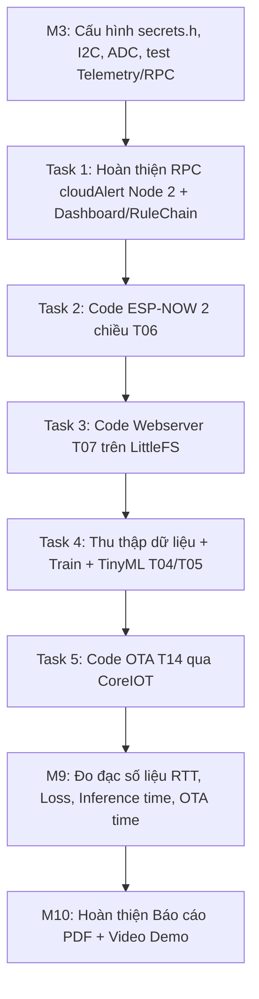

# TASKS_SPEC.md – Đặc tả kỹ thuật các phần còn thiếu 

> **Dành cho Claude Code.** File này là đặc tả **từng task** cho các phần chưa code: dọn repo, `cloudAlert` (M4), ESP-NOW (M5), Webserver (M6), TinyML (M7), OTA (M8), công cụ đo (M9).
> Bản này **thay thế** `TASKS_SPEC.md` cũ. Các điểm sai/thiếu của bản cũ đã được sửa và đánh dấu 🔧.

## 0. Cách dùng và thứ tự ưu tiên giữa các tài liệu

1. **Giao thức dữ liệu** (tên khóa telemetry, tên RPC, gói ESP-NOW): `PROJECT.md` mục 7 là nguồn sự thật, hiện thực trong `common/protocol.h`. Sửa giao thức thì sửa **`common/protocol.h` trước**, rồi hai node, rồi cập nhật `PROJECT.md`, dashboard, RuleChain.
2. **Luật code, luật debug, tiêu chí hoàn thành, minh chứng:** `CLAUDE.md`.
3. **Thao tác cấu hình trên CoreIOT:** `COREIOT_SETUP.md`. **Cài môi trường/Webserver:** `SETUP_FIRMWARE.md`. **TinyML:** `TINYML_GUIDE.md`.
4. File này: đặc tả từng task. **Nếu file này mâu thuẫn với các file trên: dừng, báo người dùng, không tự chọn.**
5. Chỉ làm **đúng task người dùng giao**. Không làm trước task sau. Có đề xuất thì ghi một dòng ở cuối câu trả lời.

### 0.1 Đọc code thật trước khi viết (bắt buộc)

Tên định danh trong file này lấy từ README và từ bản đặc tả cũ, **chưa được đối chiếu với code thật**. Trước mỗi task: `grep`/đọc code hiện có, **dùng đúng tên đang có**; nếu một tên không tồn tại thì tạo mới theo cùng phong cách và nói rõ.

| Tên giả định cần kiểm tra                                                      | Dùng cho                     |
| ------------------------------------------------------------------------------------ | ----------------------------- |
| `i2cLock()` / `i2cUnlock()`                                                      | Bus I2C (DHT20 + LCD, Node 1) |
| `appLog(tag, fmt, ...)`                                                            | Log Serial an toàn đa task  |
| `sharedGetSample()`, `sharedSetSensor()`, `sharedGetSensor()`                  | Dữ liệu cảm biến chung    |
| `RPC_CLOUD_ALERT`, `RPC_REASON_BAD_PARAMS`, `RPC_REASON_AUTO_MODE`             | Tên RPC, lý do từ chối    |
| `TK_ESPNOW_AGE_S` và các `TK_*`                                                | Khóa telemetry               |
| `PROTOCOL_VERSION`, `SENTINEL_T`, `SENTINEL_H`                                 | Giao thức, sentinel          |
| `USE_FAKE_SENSOR_DATA`, `DEBUG_LOG`, `NODE2_MAC`, `FW_TITLE`, `FW_VERSION` | `config.h`                  |
| `coreiot_link` (Wi-Fi state machine + MQTT + queue RPC)                            | Mọi thứ liên quan mạng    |

### 0.2 Hiện trạng repo (người dùng báo)

- Code thật nằm trong thư mục con `Smart_Green_House_IoT_Assignment-feature-m1-m3-firmware/`; `node1_sensor/` và `node2_actuator/` ở thư mục gốc chỉ có file mẫu → **Task 0** xử lý việc này.
- Đã có: `common/protocol.h`, `common/coreiot_link.cpp`, `common/app_log.cpp`; hai node có `shared_data` (mutex RAII); Node 1: `taskSensor`, `taskLed`, `taskDisplay`, `taskCoreiot` (telemetry + RPC `setMode`/`setHeater`); Node 2: `taskControl` (luật Auto + safe mode, đang dùng dữ liệu giả), `taskActuator`, `taskDisplay`, `taskCoreiot` (RPC `setMode`/`setFan`/`setPump`).
- Chưa kiểm chứng trên kit: LCD I2C, hiệu chỉnh độ ẩm đất, NeoPixel, kết nối CoreIOT thật.
- Môi trường: `arduino-cli`, FQBN `OhStem:esp32:yolo_uno`, core arduino-esp32 **3.1.3** (IDF 5.3). Build/nạp: `tools/flash.sh <sketch> [cổng] [giây log] [file log]` (tự thêm `--library common`).

### 0.3 Quy chuẩn code áp dụng cho mọi task

1. Mỗi chức năng một task FreeRTOS `void taskX(void*)`. Vòng lặp `for(;;)` luôn có `vTaskDelay(pdMS_TO_TICKS(..))` hoặc chờ queue/semaphore **có timeout**. Cấm `delay()` (🔧 bản cũ vi phạm ở OTA).
2. Không biến toàn cục tự do; dữ liệu chung qua getter/setter có mutex trong `shared_data`. Giữ mutex ngắn, không I2C/Serial/mạng/flash khi đang giữ mutex.
3. Cấm `String` nối chuỗi trong vòng lặp; dùng `char[]` + `snprintf`, `JsonDocument` cục bộ (ArduinoJson v7).
4. Hằng số (chân, ngưỡng, thời gian, tên topic) ở `config.h`/`protocol.h`, không số "ma thuật" trong code.
5. Callback của **ESP-NOW/Wi-Fi** chạy trong task Wi-Fi, **không phải ngắt**: chỉ kiểm tra tối thiểu + `xQueueSend(q, &x, 0)`. **Cấm `xQueueSendFromISR`** (🔧 bản cũ sai ở đây). Callback của **PubSubClient** chạy trong chính task gọi `mqtt.loop()`, được phép làm việc có giới hạn.
6. Kiểm tra giá trị trả về của mọi I/O (`esp_now_send`, `mqtt.publish`, `deserializeJson`, `Update.write`, `LittleFS.open`…); lỗi thì log `appLog` có mã lỗi, không bỏ qua.
7. Log có tiền tố: `[SENSOR] [LCD] [LED] [CTRL] [ACT] [WIFI] [MQTT] [RPC] [NOW] [WEB] [AI] [OTA] [STATS]`.
8. Không in/ghi token, mật khẩu Wi-Fi ra Serial, log, web, git. `secrets.h` bị `.gitignore`.
9. Mỗi task kết thúc bằng: build cả hai node thành công (`tools/flash.sh node1_sensor` và `node2_actuator`, chế độ chỉ build), cập nhật README (thư viện + phiên bản, trạng thái), nêu **cách kiểm tra và minh chứng cần lưu**, commit nhỏ theo `type(scope): nội dung`.
10. Kết quả trên board chỉ coi là đã kiểm chứng khi có log thật (người dùng dán, hoặc chính bạn chạy `tools/flash.sh` và bắt log). Nếu không: ghi "chưa kiểm chứng trên kit".
11. **Không tự nạp OTA** hoặc ghi đè firmware ổn định khi chưa được người dùng cho phép.

---

## Task 0 – Dọn repo (không phải milestone)

**Mục tiêu:** code thật nằm ở thư mục gốc đúng cấu trúc `PROJECT.md` mục 6; nhánh gộp về `main`; build được từ gốc.

Việc làm:

1. Xác định thư mục chứa code thật; so sánh với `node1_sensor/`, `node2_actuator/`, `common/`, `tools/` ở gốc. Chuyển bằng `git mv` (giữ lịch sử). **Không sửa logic** khi di chuyển. Xóa thư mục lồng ghép trống.
2. Kiểm `.gitignore`: `secrets.h`, `*.bin`, `build/`, `venv/`, `__pycache__/`, `ml/out/` (nếu lớn). Tìm trong lịch sử git xem có token/mật khẩu nào đã lỡ commit không (`git log -p | grep -iE "token|password|ssid"` rút gọn); nếu có, **báo người dùng** (phải đổi token).
3. Chạy build cả hai node từ gốc: `tools/flash.sh node1_sensor`, `tools/flash.sh node2_actuator`.
4. Ghi vào README mục "Cấu trúc thư mục" và bước chép `common/` cho Arduino IDE (hoặc dùng `--library common` như `flash.sh`).
5. Đề xuất (không tự làm) cách merge nhánh vào `main`.

**Hoàn thành khi:** build hai node từ gốc OK; `git status` sạch; không còn thư mục code lồng.

---

## Task 1 – Điền giá trị thật cho M1/M3 (người dùng đo, Claude cập nhật)

Claude **không** tự đoán các giá trị này. Người dùng chạy `tools/i2c_scan`, `tools/adc_calibrate`, `tools/neopixel_test` và dán kết quả. Khi nhận:

- Cập nhật `config.h` cả hai node: `LCD_I2C_ADDR`, `SOIL_RAW_DRY`, `SOIL_RAW_WET`, `NEOPIXEL_COUNT`, `NEOPIXEL_TYPE`; xóa `TODO(verify)` tương ứng.
- Cập nhật README bảng macro (chân đã kiểm chứng).
- Quy đổi độ ẩm đất: `soil% = clamp((RAW_DRY − raw) × 100 / (RAW_DRY − RAW_WET), 0, 100)`; lấy trung bình 8–16 mẫu; nếu `RAW_DRY == RAW_WET` thì báo lỗi cấu hình, không chia cho 0.
- `secrets.h` (SSID, token, host, port): người dùng tự điền, Claude không yêu cầu dán token vào chat.

---

## Task 2 (M4, phần firmware) – RPC `cloudAlert` trên Node 2

**Ngữ cảnh:** RuleChain trên CoreIOT khi alarm tạo/xóa sẽ gửi RPC `cloudAlert` sang Node 2 (xem `COREIOT_SETUP.md` mục 9). Cảnh báo phải chạy ở **mọi chế độ** (Auto và Manual) và **không** đổi trạng thái bơm/quạt.

### 2.1 Giao thức (`common/protocol.h` trước)

Nếu chưa có: `#define RPC_CLOUD_ALERT "cloudAlert"`, `RPC_REASON_BAD_PARAMS "bad_params"`. Params: `{"level":0|1|2,"msg":"<tối đa 16 ký tự>"}`.

Phản hồi two-way: `{"ok":true}`; lỗi `{"ok":false,"reason":"bad_params"}`.

### 2.2 Dữ liệu chung (`node2_actuator/shared_data`)

```cpp
struct CloudAlertState {
  uint8_t  level;       // 0 = không có; 1 = cảnh báo (vàng); 2 = nghiêm trọng (đỏ)
  char     msg[17];     // tối đa 16 ký tự + '\0'
  uint32_t expireMs;    // millis() khi hết hiệu lực
};
void sharedSetAlert(uint8_t level, const char* msg, uint32_t durationMs = 10000);
CloudAlertState sharedGetAlert();   // trả bản sao; tự coi như level 0 nếu đã hết hạn
```

Quy tắc:

- Hết hạn xử lý bằng so sánh an toàn tràn số: `(int32_t)(millis() - expireMs) >= 0`.
- `level` ngoài 0..2 → từ chối `bad_params`. `msg` thiếu → chuỗi rỗng. `msg` dài hơn 16 → cắt. Ký tự không in được/ngoài ASCII (LCD không hiển thị dấu tiếng Việt) → thay bằng `?`.
- `level == 0` → xóa ngay (đặt `expireMs` = hiện tại).
- Nhận lại cảnh báo mới → **ghi đè và gia hạn** thời gian.

### 2.3 Xử lý RPC (`task_coreiot.cpp`, hàm `handleRpc`)

- `params` phải là object (nếu không → `bad_params`).
- Gọi `sharedSetAlert(level, msg, 10000)`; **không** đổi `fan`, `pump`, `auto`; trả `{"ok":true}`.
- Telemetry Node 2 (tùy chọn, nếu thêm phải cập nhật `PROJECT.md` mục 7.2): `alert_level`.

### 2.4 Hiển thị và chấp hành

- `taskDisplay` (LCD 16×2): khi alert còn hiệu lực: dòng 0 giữ nhiệt độ/độ ẩm; dòng 1 hiển thị `msg` căn 16 ký tự (hoặc `ALERT L<level>` nếu `msg` rỗng). Hết hạn → trả lại dòng trạng thái bình thường. Không dùng `lcd.clear()`.
- `taskActuator`: `level 1` → NeoPixel vàng (255,180,0) chớp chu kỳ 500 ms; `level 2` → đỏ (255,0,0) chớp 250 ms; `level 0` → trở lại màu theo độ ẩm không khí. **Cảnh báo ghi đè màu độ ẩm**, nhưng không ghi đè D13 (quạt) và không tắt/bật bơm/quạt.
- Chớp bằng cách so `millis()` trong task (không `delay`).

### 2.5 Tự kiểm tra không cần Cloud

Thêm cờ `SELF_TEST_ALERT` trong `config.h` (mặc định 0): khi bật, `taskControl` lần lượt kích hoạt `level 1` (5 s) → `level 2` (5 s) → `level 0` sau khi khởi động, để thử LCD/NeoPixel mà chưa cần CoreIOT.

### 2.6 Hoàn thành khi

- Build OK; self-test chạy đúng trên kit (có log hoặc video).
- Từ dashboard CoreIOT (widget RPC/nút) gọi `cloudAlert` level 1/2/0 → Node 2 phản ứng; Auto hay Manual đều chạy; trạng thái quạt/bơm không đổi.
- Minh chứng: `docs/evidence/T12/cloudalert_node2.mp4`, log `[RPC]`.
- **Cấu hình RuleChain, alarm rules, notification phía CoreIOT không thuộc task này**: làm theo `COREIOT_SETUP.md` mục 6–9 (người dùng thao tác).

---

## Task 3 (M5) – ESP-NOW hai chiều (T06)

### 3.1 `common/protocol.h`

```cpp
#pragma pack(push, 1)
struct EspNowSensorPkt {            // Node 1 -> Node 2
  uint8_t  ver;          // PROTOCOL_VERSION (=1)
  uint32_t seq;          // tăng dần, bắt đầu từ 1
  float    temperature;  // °C (hoặc SENTINEL_T khi lỗi)
  float    humidity;     // % (hoặc SENTINEL_H khi lỗi)
  uint8_t  soil;         // % 0..100
  uint8_t  ai_class;     // 0..3; 255 = đang khởi động / chưa có AI
  uint8_t  heater;       // 0..255
  uint32_t tx_ms;        // millis() Node 1 lúc gửi (chỉ để log, KHÔNG dùng tính trễ một chiều)
};
struct EspNowAckPkt {               // Node 2 -> Node 1
  uint8_t  ver;
  uint32_t seq;          // seq của gói được ack
  uint32_t rx_ms;        // millis() Node 2 lúc nhận (chỉ để log)
};
#pragma pack(pop)
```

Cung cấp thêm hằng `ESPNOW_SEND_PERIOD_MS = 2000`, `ESPNOW_STALE_MS = 10000`, `ESPNOW_CHANNEL` (xem 3.5) trong `config.h`. Gói lệnh Node 2 → Node 1 (`EspNowCmdPkt`) là **mục mở rộng M5b**, chỉ làm khi người dùng yêu cầu.

### 3.2 `node1_sensor/task_espnow.cpp`

Khởi tạo: `WiFi.mode(WIFI_STA)` (hoặc `WIFI_AP_STA` khi Task 4 bật AP cứu hộ; **Wi-Fi do `coreiot_link` quản lý, không gọi lại `WiFi.mode` xung đột**), `esp_now_init()`, thêm peer Node 2 (`NODE2_MAC` trong `config.h`, `channel = 0`, `encrypt = false`), đăng ký send/recv callback.

Chữ ký callback (core 3.1.3, giữ `#if` để chạy được cả core 2.x):

```cpp
#if ESP_ARDUINO_VERSION_MAJOR >= 3
void onNowRecv(const esp_now_recv_info_t* info, const uint8_t* data, int len);
void onNowSent(const uint8_t* mac, esp_now_send_status_t status);
#else
void onNowRecv(const uint8_t* mac, const uint8_t* data, int len);
void onNowSent(const uint8_t* mac, esp_now_send_status_t status);
#endif
```

(Kiểm tra lại với header thật của core 3.1.3; nếu chữ ký khác thì theo header.)

Vòng task (chu kỳ `ESPNOW_SEND_PERIOD_MS`, `vTaskDelayUntil` để không trôi):

1. Lấy mẫu mới nhất qua getter (`sharedGetSample()`); nếu cảm biến lỗi thì gói mang giá trị sentinel và `ai_class` hiện có.
2. Đóng gói, `seq++`, `tx_ms = millis()`, ghi `tx_us[seq % 16] = micros()` cùng `seq`.
3. `esp_now_send(...)`: kiểm tra mã trả về; lỗi thì đếm `send_err`.
4. Nhận `Ack` từ queue (callback nhận chỉ copy vào queue): tìm `tx_us` theo `seq`; `rtt_us = micros() − tx_us`; log `appLog("NOW", "RTT seq=%lu rtt_us=%lu", ...)`. Ack có `seq` không khớp/đã quá cũ → bỏ qua và đếm.
5. Mỗi 10 s in thống kê: `sent`, `acked`, `ack_rate%`, `rtt_avg_us`, `rtt_max_us`, `send_err`. (Telemetry tùy chọn `now_rtt_ms`, `now_ack_pct`: nếu thêm thì cập nhật `PROJECT.md` 7.2.)

🔧 Đo trễ: **chỉ dùng RTT/2** tính bằng đồng hồ Node 1. `rx_ms` thuộc đồng hồ Node 2 nên **không được** dùng để tính độ trễ một chiều.

### 3.3 `node2_actuator/task_espnow_rx.cpp`

Khởi tạo: tương tự; tạo queue `espnowRxQueue` (8 phần tử kiểu `{EspNowSensorPkt pkt; uint8_t src[6];}`); callback nhận: kiểm tra `len == sizeof(EspNowSensorPkt)` rồi `xQueueSend(q, &item, 0)` (🔧 không dùng `...FromISR`).

Vòng task (`xQueueReceive` timeout 500 ms để còn cập nhật trạng thái "dữ liệu cũ"):

1. Với gói nhận được: kiểm tra `pkt.ver == PROTOCOL_VERSION`; sai → log và bỏ.
2. Kiểm tra nguồn: nếu `NODE1_MAC` được định nghĩa, chỉ nhận từ MAC đó.
3. 🔧 **Xử lý `seq` chịu được khởi động lại Node 1:**
   - Chưa có gói trước: nhận, đặt `lastSeq = seq`.
   - `seq == lastSeq`: trùng, **không cập nhật dữ liệu** nhưng vẫn gửi `Ack`.
   - `seq > lastSeq`: bình thường; nếu `seq > lastSeq + 1` thì `lost += seq − lastSeq − 1`.
   - `seq < lastSeq`: coi như **Node 1 vừa khởi động lại**; log `[NOW] node1 reboot detected`, `lastSeq = seq`, **vẫn nhận gói**. (Bản cũ chỉ nhận khi `seq > lastSeq` nên sau reboot Node 1 sẽ bị bỏ qua cho đến khi `seq` vượt giá trị cũ.)
4. Cập nhật dữ liệu chung bằng `sharedSetSensor(...)`: `temperature`, `humidity`, `soil`, `ai_class`, `heater_remote`, `seq`, `receivedMs = millis()`.
5. Gửi `EspNowAckPkt` về địa chỉ gửi (thêm peer Node 1 nếu chưa có).
6. **Dữ liệu cũ:** nếu `millis() − receivedMs > ESPNOW_STALE_MS` (hoặc chưa nhận gói nào): `data_stale = true` → `taskControl` vào **safe mode** (quạt OFF, bơm OFF), LCD dòng 1 hiện `NO DATA`, NeoPixel chuyển sang màu tím nhạt (cố định, không chớp để khỏi lẫn với `cloudAlert`).
7. **Dữ liệu lỗi:** nếu `ai_class == 3` hoặc nhiệt/ẩm bằng sentinel → **không điều khiển theo giá trị đó**; coi như safe mode.

Node 2: đặt `USE_FAKE_SENSOR_DATA 0` trong `config.h`. Telemetry Node 2 gửi `espnow_age_s` (`TK_ESPNOW_AGE_S`): `v.seq == 0 ? 999 : (millis() − v.receivedMs) / 1000`.

### 3.4 Thống kê và dữ liệu đo

- Log `[NOW]` đủ để tạo CSV. Tạo `tools/parse_now_log.py`: đọc file log, xuất `docs/measurements/espnow_rtt.csv` (`seq,rtt_us`) và in trung bình, p50, p95, max, tỉ lệ mất gói; đọc `lost` từ log Node 2.
- Kịch bản đo (người dùng thực hiện): ≥ 200 gói ở 1 m; 3 m; 5 m; có vật cản nếu có. Ghi vào `docs/measurements/`.

### 3.5 🔧 Rủi ro kênh Wi-Fi khi mất Internet/router (phải thử, không được bỏ qua)

ESP-NOW chỉ hoạt động khi hai node **cùng kênh**. Khi router tắt, quá trình kết nối lại có thể quét và làm đổi kênh; Wi-Fi cứu hộ (AP, Task 4) cũng đặt kênh riêng. Chưa kiểm chứng trên kit, nên task này yêu cầu:

1. `ESPNOW_CHANNEL` trong `config.h` (0 = tự theo router). Log `WiFi.channel()` mỗi khi kết nối thành công.
2. Khi kết nối lại, nếu `ESPNOW_CHANNEL != 0` thì `WiFi.begin(ssid, pass, ESPNOW_CHANNEL)` để quét đúng kênh đó (đọc `coreiot_link` để cài đúng chỗ, không viết lại state machine).
3. Khi bật AP cứu hộ: `WiFi.softAP(ssid, pass, ESPNOW_CHANNEL)` cùng kênh (nếu khác kênh ESP-NOW sẽ ngừng).
4. **Bài thử bắt buộc:** chạy ổn định → **tắt router 5 phút** → quan sát `ack_rate` và `espnow_age_s` → bật lại router. Mục tiêu: ESP-NOW vẫn trao đổi khi router tắt, và hai node nối lại Cloud khi router bật. Ghi kết quả (đạt/không đạt, chi tiết) vào `docs/evidence/T06/failover_test.txt`. Nếu không đạt: báo người dùng, **không tuyên bố đạt**.

### 3.6 Hoàn thành khi

- Build OK hai node; Node 2 hết dùng dữ liệu giả; hai chiều chạy (Ack, RTT trong log).
- ≥ 200 gói, có `espnow_rtt.csv`, tỉ lệ mất gói, thống kê.
- Safe mode khi dữ liệu cũ hoạt động (rút nguồn Node 1 → Node 2 hiện `NO DATA` sau 10 s).
- Node 1 reset → Node 2 nhận lại dữ liệu ngay (kiểm tra lỗi `seq`).
- Bài thử tắt router đã làm và ghi kết quả.
- Minh chứng: `docs/evidence/T06/` (log hai node, CSV, video).

---

## Task 4 (M6) – Webserver cục bộ + cấu hình LittleFS (T07)

### 4.1 Quyết định thiết kế (để build được bằng `arduino-cli` và tái lập được)

| Mục           | Quyết định                                                                                                                                                                                                                                                             |
| -------------- | ------------------------------------------------------------------------------------------------------------------------------------------------------------------------------------------------------------------------------------------------------------------------- |
| Thư viện web | **`WebServer.h` có sẵn trong core** (không cần thư viện ngoài). `server.handleClient()` chạy trong `taskWeb` mỗi 5–10 ms. Handler phải ngắn. `ESPAsyncWebServer` chỉ dùng nếu người dùng yêu cầu và cài được bằng `arduino-cli` |
| Giao diện     | HTML/CSS/JS **nhúng vào mã nguồn dạng `PROGMEM`** (`web_assets.h`), sinh bằng `tools/embed_web.py` từ thư mục `web/`. Không phụ thuộc bước "upload LittleFS data"                                                                             |
| LittleFS       | **Chỉ dùng để lưu `/config.json`** (ghi lúc chạy, `LittleFS.begin(true)`)                                                                                                                                                                                |
| JSON           | ArduinoJson v7                                                                                                                                                                                                                                                            |

### 4.2 Lưu cấu hình (`config_store`, dùng chung hai node, bọc `xConfigMutex`)

`/config.json`: `{"wifi_ssid","wifi_pass","mqtt_host","mqtt_port","device_token"}`.

- Khi khởi động: nếu có `/config.json` hợp lệ thì **ưu tiên** hơn `secrets.h`; không có thì dùng `secrets.h`.
- API: `configLoad()`, `configSave(...)`, getter trả bản sao (không trả con trỏ). `coreiot_link` đọc thông tin kết nối qua API này (đọc `coreiot_link` hiện có, chỉnh tối thiểu, **không phá state machine**).
- Kiểm tra độ dài: SSID ≤ 32, mật khẩu ≤ 64, host ≤ 63, token ≤ 64, cổng 1..65535. Sai → từ chối.
- **Ghi an toàn:** ghi `/config.json.tmp` rồi đổi tên; lỗi ghi → giữ file cũ.

### 4.3 API (cả hai node; khác nhau chỗ ghi chú)

| Method | Đường dẫn               | Nội dung                                                                                                                                                                                                                                                            | Ghi chú                                                               |
| ------ | --------------------------- | -------------------------------------------------------------------------------------------------------------------------------------------------------------------------------------------------------------------------------------------------------------------- | ---------------------------------------------------------------------- |
| GET    | `/`                       | trang giao diện                                                                                                                                                                                                                                                     | PROGMEM                                                                |
| GET    | `/api/state`              | Node 1: `temperature, humidity, soil, ai_class, sensor_fault, heater, auto, uptime, heap, rssi, fw_version, mqtt, espnow_*`. Node 2: `temperature, humidity, soil, fan, pump, auto, data_stale, espnow_age_s, alert_level, uptime, heap, rssi, fw_version, mqtt` | **Không** trả mật khẩu/token. Chỉ `token_set: true/false` |
| POST   | `/api/mode`               | `{"auto":true\|false}`                                                                                                                                                                                                                                              | đổi `is_auto`                                                      |
| POST   | `/api/heater`             | `{"value":0..255}`                                                                                                                                                                                                                                                 | **Node 1**, chỉ Manual                                          |
| POST   | `/api/fan`, `/api/pump` | `{"on":true\|false}`                                                                                                                                                                                                                                                | **Node 2**, chỉ Manual                                          |
| POST   | `/api/config`             | các trường 4.2 + `"confirm":true`                                                                                                                                                                                                                               | lưu, rồi khởi động lại                                           |

Quy tắc:

- 🔧 Điều khiển ở **Auto** bị từ chối: HTTP 409 + `{"ok":false,"reason":"auto_mode"}` (giống RPC). Tham số sai: 400 + `{"ok":false,"reason":"bad_params"}`.
- Handler chỉ đọc/ghi qua getter/setter có mutex rồi trả lời ngay.
- `/api/config` thiếu `confirm:true` → 400. Thành công → trả `{"ok":true}` **trước**, rồi đặt cờ; `taskWeb` (hoặc task riêng) `vTaskDelay(1500)` rồi `ESP.restart()` (không `delay`).
- Không in token/mật khẩu ra Serial.

### 4.4 AP cứu hộ (🔧 cùng kênh với ESP-NOW)

Logic nằm trong `coreiot_link`/wifi manager (một chủ duy nhất quản lý chế độ Wi-Fi), `taskWeb` chỉ hỏi trạng thái:

1. Chưa kết nối được STA sau 20 s lúc khởi động, hoặc mất STA quá 60 s → `WIFI_AP_STA`, `WiFi.softAP("GREENHOUSE-N1-SETUP" | "GREENHOUSE-N2-SETUP", AP_PASS, ESPNOW_CHANNEL)`, IP `192.168.4.1`. `AP_PASS` ≥ 8 ký tự, đặt trong `secrets.h`.
2. Khi `WiFi.softAPgetStationNum() > 0`: **tạm dừng** quét/kết nối lại STA (để người dùng nhập xong). Khi về 0 trong 30 s: thử lại STA.
3. Kết nối STA thành công: tắt AP, về `WIFI_STA`.
4. Không chặn task khác; mọi thao tác Wi-Fi không blocking quá 100 ms trong task.

### 4.5 Giao diện (`web/index.html`, tool sinh `web_assets.h`)

Một trang, 4 tab: **Trang chủ** (số liệu, cập nhật mỗi 2 s bằng `fetch('/api/state')`), **Điều khiển** (công tắc Auto/Manual; Node 1: thanh trượt sưởi 0–255; Node 2: công tắc quạt, bơm; khóa điều khiển khi Auto), **Thông tin** (SSID, IP, MAC, RSSI, heap, uptime, phiên bản firmware, trạng thái MQTT/ESP-NOW), **Cài đặt** (form cấu hình, che mật khẩu/token, nút Lưu có xác nhận). HTML5/CSS thuần, responsive, tiếng Việt UTF-8 (`<meta charset="utf-8">`), mỗi trang ≤ ~20 KB. Hiển thị lỗi khi API trả lỗi (ví dụ "Đang ở chế độ Auto").

### 4.6 `tools/embed_web.py`

Đọc `web/index.html` (kèm CSS/JS inline) → ghi `nodeX/web_assets.h` với `const char INDEX_HTML[] PROGMEM = R"rawliteral(...)rawliteral";`. Chạy được lại bằng một lệnh, ghi vào README.

### 4.7 Hoàn thành khi

- Build OK hai node; mở `http://<IP>/` từ điện thoại và laptop thấy dữ liệu cập nhật.
- Manual điều khiển được; Auto bị từ chối với thông báo đúng.
- Mở 3 tab/thiết bị cùng lúc: các task khác (cảm biến, LCD, MQTT) không bị ảnh hưởng (có `[STATS]`).
- Đổi cấu hình qua `/settings` → khởi động lại → vào mạng mới.
- Tắt router → AP cứu hộ lên đúng thời gian; vào `192.168.4.1` đổi lại được; AP cùng kênh `ESPNOW_CHANNEL`.
- Đo: độ trễ phản hồi điều khiển (≥ 20 lần), thời gian từ mất Wi-Fi đến lúc AP lên → `docs/measurements/web_latency.csv`.
- Minh chứng: ảnh từng trang của **cả hai node**, video, `docs/evidence/T07/`.

---

## Task 5 (M7) – TinyML (T04, T05)

Đọc `TINYML_GUIDE.md` trước. Task này **hiện thực hóa** hướng dẫn đó trên repo; các quyết định chính:

| Mục                              | Quyết định                                                                                                                                                                                                      |
| --------------------------------- | ------------------------------------------------------------------------------------------------------------------------------------------------------------------------------------------------------------------ |
| Lớp                              | `0` normal, `1` soil_dry, `2` hot_humid, `3` sensor_fault; `255` = đang khởi động                                                                                                                    |
| Đầu vào                        | cửa sổ 5 mẫu × (T, H, soil) = 15 giá trị; chu kỳ 2 s                                                                                                                                                        |
| Chuẩn hóa                       | `t=(T−25)/25`, `h=(H−50)/50`, `s=(soil−50)/50` — hằng số cố định, **một nơi** trong `config.h`                                                                                            |
| Sentinel (cảm biến lỗi)        | `T = SENTINEL_T = −40`, `H = SENTINEL_H = 0` khi đọc lỗi hoặc ngoài dải (T < −10 hoặc > 80; H < 0 hoặc > 100)                                                                                        |
| Mô hình                         | MLP 15→32→16→4. **float32 trước, INT8 nếu chạy tốt** (🔧 bản cũ chỉ INT8)                                                                                                                         |
| Thư viện chạy trên thiết bị | `Chirale_TensorFlowLite` (cài bằng `arduino-cli lib install`, ghi phiên bản vào README). Nếu không biên dịch được với core 3.1.3 thì dùng suy luận MLP viết tay bằng C và **ghi rõ** |

### 5.1 5a – Firmware thu dữ liệu (`tools/collect_firmware/`)

In mỗi 2000 ms một dòng `D,<millis>,<t>,<h>,<soil>` (áp quy tắc sentinel). Dùng lại logic đọc cảm biến và hiệu chỉnh đất của `node1_sensor` (không copy sai lệch). 🔧 Dùng dòng `D,` riêng; **không** parse log `[SENSOR]` (định dạng log có thể đổi).

### 5.2 5b – Công cụ Python (`ml/`)

Tạo/chạy thử `collect_serial.py`, `train.py`, `export_tflite.py`, `requirements.txt` theo `TINYML_GUIDE.md` mục 4, 6, 7. Điểm bắt buộc:

- 🔧 **Mỗi file CSV = một phiên + một nhãn**; chia train/val/test **theo phiên** (mỗi lớp ≥ 3 phiên), không chia ngẫu nhiên từng cửa sổ.
- Dữ liệu lỗi **tổng hợp** tách riêng khỏi dữ liệu thật; đánh giá và báo cáo **riêng**.
- Có baseline luật ngưỡng để so sánh; xuất `out/report.txt`, `confusion_*.png`, `curves.png`, `meta.json`.
- `export_tflite.py` xuất `model_float.tflite`, `model_int8.tflite`, `model.h` (bản được chọn, tên mảng `g_model`, độ dài `g_model_len`), `test_vectors.h`, và in kích thước + độ chính xác từng bản.
- Nếu độ chính xác thật ≈ 100%: **dừng và kiểm tra rò rỉ** trước khi báo cáo; nói thẳng nếu bài toán dễ.
- Claude **không tự bịa dữ liệu thu thật**. Không có dữ liệu thật thì chỉ chạy thử đường ống bằng dữ liệu mẫu nhỏ và ghi rõ đó là dữ liệu thử.

### 5.3 5c – Parity test (`tools/tinyml_parity/`)

Sketch nạp `model.h` + `test_vectors.h`, chạy 20 vector, in `device=… expect=… OK/MISMATCH` và thời gian (µs). **Mục tiêu:** 20/20 khớp (bản float). Ghi `kArenaSize` tối thiểu chạy được (+20% dư). Log lưu `docs/evidence/T04/parity_log.txt`.

### 5.4 5d – `task_tinyml.cpp` (Node 1)

- Chờ semaphore/sự kiện "có mẫu mới" từ `taskSensor` (timeout 3 s); **không** chặn `taskSensor`.
- Bộ đệm vòng 5 mẫu (đã áp sentinel). Chưa đủ 5 mẫu → `ai_class = 255` (🔧 bản cũ trả 0 là "bình thường", che lỗi lúc khởi động).
- Chuẩn hóa → (nếu INT8: lượng tử hóa bằng `scale/zero_point` **đọc từ tensor đầu vào**, không hard-code) → `Invoke()` → `argmax`.
- Đo `micros()` quanh `Invoke()`; log `[AI] class=<c> p=<xác suất> t_us=<µs>`.
- Làm mượt: nhãn công bố = **đa số của 3 lần gần nhất**; vẫn log nhãn thô.
- `tensorArena` tĩnh `alignas(16)`, log kích thước; stack task khởi điểm 8192, in `uxTaskGetStackHighWaterMark`.
- Ghi `ai_class` và `sensor_fault` vào `shared_data` (mutex); thêm khóa `TK_AI_CLASS`, `TK_SENSOR_FAULT` vào `protocol.h` nếu chưa có.
- **Tác động hệ thống (T04):**
  - `taskCoreiot` Node 1 luôn gửi `ai_class` (không gửi khi `255`).
  - Khi `ai_class == 3`: **không gửi** `temperature/humidity/soil` lên Cloud; gửi `sensor_fault: true`.
  - `taskDisplay` Node 1: hiện `FAULT`.
  - `taskLed`: giữ an toàn cứng (sưởi 0 khi dữ liệu không hợp lệ).
  - Gói ESP-NOW mang `ai_class` thật.
- Không dùng `delay`; stack/heap ổn định ≥ 30 phút.

### 5.5 Hoàn thành khi

- Pipeline `collect → train → export` chạy lại được từ đầu bằng các lệnh trong README.
- Parity 20/20 (float), có thời gian suy luận trung bình và arena tối thiểu.
- Video: đổi điều kiện (làm ấm DHT20, nhúng đầu dò đất vào nước, rút dây DHT20) → `ai_class` đổi trên LCD/dashboard; khi lỗi, dữ liệu hỏng **không** lên Cloud.
- Số liệu: số mẫu/phiên, accuracy thật và tổng hợp (riêng), baseline, kích thước float vs INT8.
- Minh chứng: `docs/evidence/T04/`, `docs/evidence/T05/`.

---

## Task 6 (M8) – OTA qua CoreIOT (T14)

⚠️ Rủi ro cao nhất: **không tự nạp OTA**; xin phép người dùng, và nhắc giữ cáp USB + bản `.bin` ổn định để nạp lại.

### 6.1 Điều kiện

- **Partition scheme có hai slot ứng dụng.** Tìm tùy chọn đúng: `arduino-cli board details -b OhStem:esp32:yolo_uno --list-all`; chọn scheme OTA (có `app0` và `app1`), cập nhật `tools/flash.sh` (`--board-options`) và README. Nạp lại bằng cáp với scheme mới **trước** khi thử OTA.
- `config.h` mỗi node: `FW_TITLE` (`"greenhouse-node1"`/`"greenhouse-node2"`) và `FW_VERSION` (bắt đầu `"1.0.0"`).
- `MQTT_BUFFER_SIZE` ≥ `OTA_CHUNK_SIZE + 256` (🔧 bản cũ không đặt; buffer mặc định 256 byte của PubSubClient làm rơi chunk). Mặc định `OTA_CHUNK_SIZE = 4096` (có thể giảm xuống 1024 khi gặp lỗi bộ nhớ).

### 6.2 Quy trình (topic đã đối chiếu tài liệu ThingsBoard; vẫn phải kiểm tra thực tế trên CoreIOT của lớp)

1. **Subscribe:** `v1/devices/me/attributes` (cập nhật shared attribute), `v1/devices/me/attributes/response/+`, `v2/fw/response/+/chunk/+`.
2. 🔧 **Chủ động hỏi lúc khởi động** (và mỗi lần kết nối MQTT lại): publish `v1/devices/me/attributes/request/1` với `{"sharedKeys":"fw_title,fw_version,fw_size,fw_checksum,fw_checksum_algorithm"}`. (Bản cũ chỉ chờ thông báo nên nếu gán firmware lúc thiết bị tắt thì OTA không bao giờ bắt đầu.) Phản hồi có thể nằm trong `"shared"`; thông báo cập nhật có thể ở dạng phẳng; xử lý cả hai.
3. **Báo phiên bản hiện tại** ngay sau khi kết nối: telemetry `{"current_fw_title":FW_TITLE,"current_fw_version":FW_VERSION,"fw_state":"UPDATED"}` (chỉ `UPDATED` nếu vừa khởi động sau OTA; ngược lại chỉ gửi `current_fw_*`).
4. **Điều kiện bắt đầu:** `fw_size > 0` và (`fw_title != FW_TITLE` hoặc `fw_version != FW_VERSION`).
5. 🔧 **Chống lặp vô hạn:** lưu số lần thử vào NVS (`Preferences`) theo `fw_version` đích. Quá 3 lần thất bại hoặc sau khi cập nhật mà phiên bản vẫn không đổi → `{"fw_state":"FAILED","fw_error":"version unchanged"}` và dừng thử đến khi `fw_version` đích đổi.
6. **Tải:** `Update.begin(fw_size, U_FLASH)` (lỗi → `FAILED`, `fw_error:"update begin"`). Với `requestId` mới mỗi phiên, lần lượt `i = 0,1,2…`: publish `v2/fw/request/<requestId>/chunk/<i>` payload là **kích thước chunk dạng chuỗi số thập phân** (ví dụ `"4096"`). Nhận chunk ở topic `v2/fw/response/<requestId>/chunk/<i>` (payload là byte thô); kiểm tra `i` đúng thứ tự mong đợi; `Update.write(...)` kiểm tra số byte ghi; cập nhật hash băm dần; chỉ yêu cầu chunk kế tiếp **sau khi ghi xong**. Kết thúc khi đủ `fw_size` byte.
7. **Timeout/retry:** mỗi chunk chờ 10 s, thử lại tối đa 3 lần, quá thì `Update.abort()` và `FAILED` (`fw_error:"chunk timeout"`). Mất kết nối MQTT giữa chừng: `Update.abort()`, giữ firmware cũ.
8. **Telemetry trạng thái:** `{"fw_state":"DOWNLOADING"}` (kèm `fw_progress` phần trăm, tối đa 1 lần/giây), `DOWNLOADED`, `VERIFIED`, `UPDATING`, `FAILED` (+`fw_error`). Tên trạng thái cần đối chiếu thực tế với CoreIOT.
9. **Checksum:** đọc `fw_checksum_algorithm`; hỗ trợ **SHA256** và **MD5** (mbedtls, băm dần khi nhận chunk). Thuật toán khác → `FAILED` (`fw_error:"unsupported checksum"`). So khớp hex không phân biệt hoa thường. Sai → `Update.abort()`, `FAILED` (`fw_error:"checksum mismatch"`).
10. **Hoàn tất:** `Update.end(true)` → `{"fw_state":"UPDATING"}` → đặt đầu ra an toàn (Node 1: sưởi 0; Node 2: quạt/bơm OFF) → `vTaskDelay(pdMS_TO_TICKS(1000))` (🔧 không `delay`) → `ESP.restart()`.
11. Không bắt đầu OTA khi đang ghi `/config.json`. Trong lúc OTA các task khác (cảm biến, điều khiển an toàn) vẫn chạy; `taskCoreiot` tiếp tục `mqtt.loop()`.

### 6.3 Công cụ

`tools/make_ota_bin.sh <sketch>`: chạy `arduino-cli compile --export-binaries ...`, in đường dẫn file `<sketch>.ino.bin` (**không phải** `bootloader`/`partitions`/`merged`), kích thước, SHA256, MD5. Ghi README: cách đổi `FW_VERSION`, build bản `1.0.1`, upload lên CoreIOT (`COREIOT_SETUP.md` mục 10).

### 6.4 Hoàn thành khi (người dùng thao tác, Claude hỗ trợ đọc log)

1. Nạp `1.0.0` bằng cáp; thiết bị online, dashboard hiện `current_fw_version = 1.0.0`.
2. Upload gói `1.0.1`, gán cho `Node1` → thiết bị đi qua `DOWNLOADING → DOWNLOADED → VERIFIED → UPDATING → UPDATED`, version đổi sang `1.0.1`. Lặp ≥ 3 lần, ghi thời gian vào `docs/measurements/ota_time.csv` kèm kích thước `.bin`.
3. Thử lỗi: ngắt Wi-Fi giữa chừng → thiết bị chạy tiếp bản cũ, báo `FAILED`, và OTA lại thành công sau khi mạng trở lại.
4. Thử gán firmware **khi thiết bị đang tắt** rồi bật → vẫn tự cập nhật (kiểm tra bước 6.2.2).
5. Minh chứng: `docs/evidence/T14/before.png`, `after.png`, `ota_log.txt`, `ota_demo.mp4`.

---

## Task 7 (M9) – Công cụ đo đạc (`tools/`)

| Công cụ                           | Việc                                                                                                   | Đầu ra                                          |
| ----------------------------------- | ------------------------------------------------------------------------------------------------------- | ------------------------------------------------- |
| `parse_now_log.py`                | RTT, tỉ lệ mất gói ESP-NOW từ log Serial                                                           | `docs/measurements/espnow_rtt.csv` + thống kê |
| `parse_stats_log.py`              | Trích `[STATS]` (heap, stack) → CSV, vẽ đồ thị heap theo thời gian                             | `docs/measurements/heap_node{1,2}.csv`, PNG     |
| `rpc_latency_log.py` (tùy chọn) | Ghi thời điểm lệnh/thời điểm thiết bị phản hồi nếu người dùng có cách chốt thời gian | `docs/measurements/rpc_latency.csv`             |
| `summarize_measurements.py`       | Tổng hợp mọi CSV thành bảng cho Chương 4 (trung bình, p95, max, N)                              | `docs/measurements/summary.md`                  |

Quy tắc: chỉ xử lý số đo thật; không điền số ước lượng; ghi N (số mẫu) và điều kiện đo (khoảng cách, mạng, ngày giờ). Script không có dữ liệu → báo rõ "không có dữ liệu", không bịa.

---

## 8. Thứ tự thực hiện và phụ thuộc

```
Task 0 (dọn repo)
  → Task 1 (giá trị thật M1/M3: người dùng đo)
  → [người dùng cấu hình CoreIOT theo COREIOT_SETUP.md mục 3–5: M3]
  → Task 2 (cloudAlert) + [người dùng làm dashboard/alarm/RuleChain/notification: M4]
  → Task 3 (ESP-NOW)                   (Node 2 hết dữ liệu giả)
  → Task 4 (Webserver + config_store)  (OTA và AP cứu hộ dùng config_store)
  → Task 5 (TinyML)                    (thu dữ liệu cần Task 1 xong và Node 1 ổn định)
  → Task 6 (OTA)                       (làm sau cùng vì rủi ro cao nhất)
  → Task 7 (đo đạc) → báo cáo/video
```

Nếu thiếu thời gian: giữ T04, T05, T06, T07, T11, T12, T13; bỏ Task 6 (T14) và thay bằng T08 hoặc T10 để vẫn đủ 8 điểm (tổng bỏ OTA chỉ còn 7.0).

## 9. Mẫu lệnh giao cho Claude Code

> Đọc `CLAUDE.md`, `PROJECT.md` và `TASKS_SPEC.md` (mục 0 và **Task X**). Làm đúng **Task X**. Trạng thái: `<đã xong gì; giá trị đo thật; log/lỗi nếu có>`. Đọc code hiện có trước, dùng đúng tên định danh đang có. Nêu kế hoạch ngắn, rồi đưa thay đổi theo từng file, build hai node, nêu cách kiểm tra và minh chứng cần lưu. Không làm task khác. Không tự nạp OTA.

## 10. Điều cấm (tóm tắt)

Không tự sửa giao thức ở một node mà không cập nhật `protocol.h`, node còn lại, `PROJECT.md`, dashboard; không `delay()` trong task; không `xQueueSendFromISR` trong callback ESP-NOW; không `String` trong vòng lặp; không in/ghi token hay mật khẩu; không bịa số đo hoặc dữ liệu thu; không tuyên bố "đã chạy tốt" khi chưa có log từ kit; không làm trước task chưa được giao; không nạp OTA khi chưa được phé

# TASKS_SPEC.md – Đặc tả kỹ thuật code các phần còn thiếu cho Claude Code

> **Dành cho Claude Code (và lập trình viên):**
> File này chứa **toàn bộ đặc tả kỹ thuật chi tiết** của các file chưa được code trong dự án.
> Khi nhận yêu cầu làm một milestone/task nào, Claude Code **phải đọc mục tương ứng trong file này** để cài đặt chính xác 100% về kiến trúc, tên biến, tên hàm, giao thức, thread-safety và tương thích phần cứng, **không được tự chế lại giao thức hay biến tấu API**.

---

## 📑 Mục lục các Task cần thực hiện

- [Quy chuẩn cốt lõi khi code](#0-quy-chuẩn-cốt-lõi-khi-code)
- [Task 1 (M4): Hoàn thiện RPC `cloudAlert` trên Node 2](#task-1-m4-hoàn-thiện-rpc-cloudalert-trên-node-2)
- [Task 2 (M5): Giao tiếp không dây ESP-NOW (T06)](#task-2-m5-giao-tiếp-không-dây-esp-now-t06)
  - [2.1 Cập nhật `common/protocol.h`](#21-cập-nhật-commonprotocolh)
  - [2.2 Cài đặt `node1_sensor/task_espnow.cpp`](#22-cài-đặt-node1_sensortask_espnowcpp)
  - [2.3 Cài đặt `node2_actuator/task_espnow_rx.cpp`](#23-cài-đặt-node2_actuatortask_espnow_rxcpp)
- [Task 3 (M6): Local Webserver &amp; Cấu hình LittleFS (T07)](#task-3-m6-local-webserver--cấu-hình-littlefs-t07)
  - [3.1 Webserver Backend (`task_web.cpp`)](#31-webserver-backend-task_webcpp)
  - [3.2 Giao diện Frontend (`data/index.html`, `style.css`, `app.js`)](#32-giao-diện-frontend-dataindexhtml-stylecss-appjs)
- [Task 4 (M7): Hệ thống TinyML cục bộ (T04, T05)](#task-4-m7-hệ-thống-tinyml-cục-bộ-t04-t05)
  - [4.1 Bộ công cụ thu thập &amp; huấn luyện Python (`ml/`)](#41-bộ-công-cụ-thu-thập--huấn-luyện-python-ml)
  - [4.2 Firmware suy luận TinyML trên Node 1 (`task_tinyml.cpp`)](#42-firmware-suy-luận-tinyml-trên-node-1-task_tinymlcpp)
- [Task 5 (M8): Cập nhật Firmware từ xa OTA qua CoreIOT (T14)](#task-5-m8-cập-nhật-firmware-từ-xa-ota-qua-coreiot-t14)
  - [5.1 Module OTA (`task_ota.cpp`)](#51-module-ota-task_otacpp)
- [Thứ tự thực hiện khuyến nghị](#thứ-tự-thực-hiện-khuyến-nghị)

---

## 0. Quy chuẩn cốt lõi khi code

1. **FreeRTOS Task chuẩn mực:** Mọi hàm task có signature `void taskName(void *arg)`. Vòng lặp `for (;;)` phải có `vTaskDelay(pdMS_TO_TICKS(period))` hoặc chờ Queue/Semaphore có timeout. Cấm tuyệt đối `delay()`.
2. **Không biến toàn cục tự do:** Truy cập biến chia sẻ phải qua getter/setter bọc Mutex trong `shared_data.cpp`.
3. **Bộ nhớ:** Cấm `String` trong vòng lặp. Dùng `char buf[N]` + `snprintf` hoặc `JsonDocument` cục bộ (ArduinoJson v7).
4. **I2C Bus:** Không gọi `Wire.begin()` nhiều lần. Node 1 có chung I2C (DHT20 + LCD) bắt buộc dùng `i2cLock()`/`i2cUnlock()`.
5. **Đồng bộ giao thức:** Khi thêm struct hay method RPC, bắt buộc sửa `common/protocol.h` trước rồi mới include vào 2 node.

---

## Task 1 (M4): Hoàn thiện RPC `cloudAlert` trên Node 2

### 1.1 Mục tiêu

RuleChain CoreIOT khi phát hiện bất thường từ Node 1 sẽ gửi RPC `cloudAlert` tới Node 2. Node 2 phải hiển thị cảnh báo lên LCD và chớp NeoPixel mà **không làm thay đổi trạng thái bơm/quạt đang chạy tự động**.

### 1.2 Chi tiết thay đổi

#### A. Cập nhật `node2_actuator/shared_data.h` & `shared_data.cpp`

Thêm struct lưu trữ alert:

```cpp
struct CloudAlertState {
  uint8_t level;       // 0: Khong co alert; 1: Canh bao vang; 2: Nguy hiem do
  char msg[17];        // Toi da 16 ky tu + null terminator
  uint32_t expireMs;   // millis() khi het han hien thi
};

void sharedSetAlert(uint8_t level, const char *msg, uint32_t durationMs = 10000);
CloudAlertState sharedGetAlert();
```

#### B. Sửa `node2_actuator/task_coreiot.cpp`

Trong hàm `handleRpc(const RpcRequest &req)`:

```cpp
else if (strcmp(method, RPC_CLOUD_ALERT) == 0) {
  JsonVariantConst params = in["params"];
  if (!params.is<JsonObjectConst>()) {
    reason = RPC_REASON_BAD_PARAMS;
  } else {
    uint8_t level = params["level"] | 0;
    const char *msg = params["msg"] | "";
    sharedSetAlert(level, msg, 10000);
  }
}
```

#### C. Sửa `node2_actuator/task_display.cpp`

Kiểm tra `sharedGetAlert()`:

- Nếu `alert.level > 0` và `millis() < alert.expireMs`:
  - Dòng 0: Giữ thông tin nhiệt ẩm hoặc hiện `[ALARM LEVEL X]`.
  - Dòng 1: Hiển thị đè nội dung `alert.msg` (căn lề 16 ký tự).
- Khi hết hạn: Tự động hoàn lại dòng 1 bình thường (`PUMP:... F:... A`).

#### D. Sửa `node2_actuator/task_actuator.cpp`

- Nếu `alert.level == 1`: Chớp NeoPixel màu vàng (255, 180, 0) chu kỳ 500ms.
- Nếu `alert.level == 2`: Chớp NeoPixel màu đỏ (255, 0, 0) chu kỳ 250ms.
- Nếu `alert.level == 0`: Trả lại NeoPixel hiển thị theo độ ẩm không khí như cũ.

---

## Task 2 (M5): Giao tiếp không dây ESP-NOW (T06)

### 2.1 Cập nhật `common/protocol.h`

Bổ sung định nghĩa gói tin ESP-NOW vào cuối file:

```cpp
// ---- ESP-NOW Packet (Node 1 -> Node 2) ----
#pragma pack(push, 1)
struct EspNowSensorPkt {
  uint8_t ver;        // PROTOCOL_VERSION (= 1)
  uint32_t seq;       // So thu tu goi tin tang dan
  float temperature;  // Do C (hoac SENTINEL_T)
  float humidity;     // %
  uint8_t soil;       // % (0..100)
  uint8_t ai_class;   // 0: Normal, 1: Dry, 2: Hot/Humid, 3: Fault
  uint8_t heater;     // 0..255 muc suoi hien tai cua Node 1
  uint32_t tx_ms;     // millis() luc Node 1 gui
};

struct EspNowAckPkt {
  uint8_t ver;
  uint32_t seq;       // seq cua goi Pkt duoc ack
  uint32_t rx_ms;     // millis() luc Node 2 nhan duoc
};
#pragma pack(pop)
```

### 2.2 Cài đặt `node1_sensor/task_espnow.cpp`

1. **Khởi tạo:**
   - Đảm bảo `WiFi.mode(WIFI_STA)` (đã có từ coreiot_link).
   - Gọi `esp_now_init()`.
   - Lấy MAC Node 2 từ `config.h` (`NODE2_MAC`), gọi `esp_now_add_peer(...)`.
   - Đăng ký `esp_now_register_send_cb(...)` và `esp_now_register_recv_cb(...)`.
   - **Tương thích core 3.x vs 2.x:**
     ```cpp
     #if ESP_ARDUINO_VERSION_MAJOR >= 3
     void onNowRecv(const esp_now_recv_info_t *info, const uint8_t *data, int len);
     void onNowSent(const uint8_t *mac_addr, esp_now_send_status_t status);
     #else
     void onNowRecv(const uint8_t *mac, const uint8_t *data, int len);
     void onNowSent(const uint8_t *mac_addr, uint8_t status);
     #endif
     ```
2. **Xử lý vòng lặp task:**
   - Chu kỳ gửi: 2000 ms (`pdMS_TO_TICKS(2000)`).
   - Lấy mẫu mới nhất từ `sharedGetSample()`.
   - Đóng gói struct `EspNowSensorPkt` với `seq++`, `tx_ms = millis()`.
   - Gọi `esp_now_send(targetMac, (uint8_t*)&pkt, sizeof(pkt))`.
   - Nhận `EspNowAckPkt` qua Queue (đẩy từ recv callback): tính Round-Trip Time `rtt = millis() - pkt.tx_ms`.
   - Nếu `DEBUG_LOG`: in RTT để dùng làm số liệu đo đạc cho Chương 4.

### 2.3 Cài đặt `node2_actuator/task_espnow_rx.cpp`

1. **Khởi tạo:**
   - `WiFi.mode(WIFI_STA)`, `esp_now_init()`.
   - Thêm peer Node 1 để có thể gửi `Ack`.
   - Tạo FreeRTOS Queue `espnowRxQueue` kích thước 8 phần tử.
   - Callback `onNowRecv`: Chỉ copy memory vào queue và gọi `xQueueSendFromISR`.
2. **Xử lý vòng lặp task:**
   - Đọc queue bằng `xQueueReceive(espnowRxQueue, &pkt, portMAX_DELAY)`.
   - Kiểm tra `pkt.ver == PROTOCOL_VERSION` và `pkt.seq > lastSeq`.
   - Cập nhật vào Node 2 `sharedSetSensor(...)`:
     - `temperature = pkt.temperature`
     - `humidity = pkt.humidity`
     - `soil = pkt.soil`
     - `seq = pkt.seq`
     - `receivedMs = millis()`
   - Đóng gói `EspNowAckPkt` gửi ngược lại Node 1 qua `esp_now_send`.
3. **Cập nhật Node 2:**
   - Trong `node2_actuator/config.h`: Đổi `#define USE_FAKE_SENSOR_DATA 0`.
   - Trong `node2_actuator/task_coreiot.cpp`: Gửi thêm trường `espnow_age_s` trong telemetry:
     ```cpp
     SensorView v = sharedGetSensor();
     doc[TK_ESPNOW_AGE_S] = (v.seq == 0) ? 999 : (millis() - v.receivedMs) / 1000;
     ```

---

## Task 3 (M6): Local Webserver & Cấu hình LittleFS (T07)

### 3.1 Webserver Backend (`task_web.cpp`)

Cài đặt cho cả Node 1 và Node 2 (có thể tái sử dụng cấu trúc, chỉ khác các endpoint điều khiển).

1. **Khởi động LittleFS:** `LittleFS.begin(true)` để load file tĩnh (`index.html`, `style.css`, `app.js`).
2. **Khởi động Webserver:** Sử dụng `WebServer` (Arduino chuẩn) hoặc `ESPAsyncWebServer` cổng 80:
   - `GET /` -> Đọc và trả về file `/index.html`.
   - `GET /api/status` -> Trả về JSON:
     - Node 1: `{temperature, humidity, soil, heater, autoMode, uptime, heap, rssi, fw_version}`
     - Node 2: `{temperature, humidity, soil, fan, pump, autoMode, dataStale, uptime, heap, rssi, fw_version}`
   - `POST /api/control` -> Nhận JSON đổi chế độ:
     - `{"auto": true/false}`
     - Node 1: `{"heater": 0..255}` (khi Manual)
     - Node 2: `{"fan": true/false, "pump": true/false}` (khi Manual)
   - `POST /api/config` -> Nhận JSON cấu hình mới (`wifi_ssid`, `wifi_pass`, `mqtt_host`, `mqtt_port`, `device_token`), ghi vào file `/config.json` trên LittleFS và hẹn giờ khởi động lại sau 2 giây.
3. **Chế độ AP Cứu hộ (Fallback AP):**
   - Nếu Wi-Fi STA mất kết nối quá 60 giây hoặc không kết nối được lúc khởi động:
   - Kích hoạt `WiFi.mode(WIFI_AP_STA)` với SSID `Greenhouse-Node1-Rescue` (không pass hoặc pass `12345678`), IP mặc định `192.168.4.1`.
   - Người dùng kết nối vào AP để cấu hình lại Wi-Fi/Token qua trình duyệt.

### 3.2 Giao diện Frontend (`data/index.html`, `style.css`, `app.js`)

- Dùng HTML5/CSS3 thuần, giao diện responsive (Bootstrap mini hoặc custom Flexbox/Grid hiện đại).
- Hiển thị trực quan: thẻ số đo thời gian thực (tự động fetch mỗi 2s), công tắc Auto/Manual, slider điều khiển sưởi/quạt/bơm, bảng thông số WiFi & hệ thống.

---

## Task 4 (M7): Hệ thống TinyML cục bộ (T04, T05)

### 4.1 Bộ công cụ thu thập & huấn luyện Python (`ml/`)

Tạo các file trong thư mục `ml/`:

1. **`requirements.txt`:**
   ```txt
   tensorflow>=2.14.0
   numpy>=1.24.0
   pandas>=2.0.0
   scikit-learn>=1.3.0
   pyserial>=3.5
   matplotlib>=3.7.0
   ```
2. **`collect_serial.py`:**
   - Dòng lệnh: `python collect_serial.py --port COM3 --baud 115200 --label 0 --output data/normal.csv`
   - Đọc từng dòng Serial từ Node 1 dạng `[SENSOR] seq=... T=28.4 H=65.2 soil=42`.
   - Ghi vào file CSV các cột: `timestamp,temperature,humidity,soil,label`.
   - Bắt lỗi ngắt dòng, bỏ qua dòng rác.
3. **`train.py`:**
   - Đọc toàn bộ các file CSV trong `ml/data/`.
   - Tạo đặc trưng với **cửa sổ trượt (sliding window)** kích thước 5 bước: $5 \times 3 = 15$ đặc trưng đầu vào.
   - Chuẩn hóa cố định:
     $$
     t_{norm} = \frac{T - 25.0}{25.0}, \quad h_{norm} = \frac{H - 50.0}{50.0}, \quad s_{norm} = \frac{\text{soil} - 50.0}{50.0}
     $$
   - Xây dựng mô hình MLP gọn nhẹ:
     - Input(15) -> Dense(32, activation='relu') -> Dense(16, activation='relu') -> Dense(4, activation='softmax')
   - 4 lớp đầu ra:
     - `0`: Bình thường (Normal)
     - `1`: Đất khô cần tưới (Dry soil)
     - `2`: Quá nóng / Quá ẩm (High temperature / humidity)
     - `3`: Cảm biến lỗi (Sensor Fault - sentinel T=-40 hoặc H=0)
   - Huấn luyện với early stopping, vẽ Confusion Matrix lưu thành `docs/evidence/T05/confusion_matrix.png`.
4. **`export_tflite.py`:**
   - Xuất mô hình thành file TFLite float32 và TFLite INT8 (Full Integer Quantization).
   - So sánh kích thước và độ chính xác của 2 bản.
   - Chuyển đổi mô hình INT8 thành mảng C header: lưu vào `node1_sensor/model.h`:
     ```c
     alignas(16) const unsigned char g_model[] = { 0x1c, ... };
     const unsigned int g_model_len = 3456;
     ```
   - Xuất `ml/test_vectors.h` chứa một số mẫu kiểm thử để đối chiếu suy luận giữa Python và C++.

### 4.2 Firmware suy luận TinyML trên Node 1 (`task_tinyml.cpp`)

1. **Khởi tạo:**
   - Cấp phát tĩnh tensor arena: `constexpr size_t ARENA_SIZE = 8192; alignas(16) static uint8_t tensorArena[ARENA_SIZE];`
   - Khởi tạo TensorFlow Lite Micro Interpreter (dùng thư viện `Chirale_TensorFlowLite` hoặc `tflite-micro-esp32`).
   - Load `g_model` từ `model.h`.
2. **Buffer cửa sổ trượt:**
   - Lưu trữ 5 mẫu gần nhất (mỗi mẫu gồm T, H, soil).
   - Khi có mẫu mới từ `sharedGetSample()`: Đẩy vào buffer vòng (FIFO).
   - Khi chưa đủ 5 mẫu: Tạm trả về `ai_class = 0`.
3. **Tiền xử lý & Chuẩn hóa:**
   - Chuẩn hóa 15 giá trị theo đúng công thức ở 4.1.
   - Áp dụng Quantization scale & zero_point của input tensor để chuyển float sang `int8`.
4. **Suy luận & Xử lý:**
   - Đo thời gian suy luận:
     ```cpp
     uint32_t startUs = micros();
     TfLiteStatus status = interpreter->Invoke();
     uint32_t inferDurationUs = micros() - startUs;
     ```
   - Tìm index có xác suất cao nhất trong output tensor -> `ai_class`.
   - Cập nhật `ai_class` vào `shared_data`.
   - Nếu `ai_class == 3`: Bật cờ `sensor_fault = true` trong telemetry Node 1, hiển thị cảnh báo `FAULT` lên LCD.
   - In log suy luận: `appLog("AI", "class=%u duration=%lu us", ai_class, inferDurationUs);`.

---

## Task 5 (M8): Cập nhật Firmware từ xa OTA qua CoreIOT (T14)

### 5.1 Module OTA (`task_ota.cpp`)

1. **Khởi tạo & Lắng nghe:**
   - Subscribe shared attributes từ CoreIOT: topic `v1/devices/me/attributes`.
   - Đăng ký nhận payload chứa:
     - `fw_title`, `fw_version`, `fw_size`, `fw_checksum`, `fw_checksum_algorithm`.
2. **Kiểm tra phiên bản:**
   - Nếu `strcmp(fw_version, FW_VERSION) != 0` và `fw_size > 0`:
   - Gửi telemetry báo bắt đầu tải: `{"fw_state": "DOWNLOADING"}`.
3. **Tải firmware theo từng Chunk:**
   - Subscribe topic nhận chunk: `v2/fw/response/+/chunk/+`.
   - Kích thước chunk: 1024 hoặc 2048 byte.
   - Request chunk `i`: Publish tới `v2/fw/request/1/chunk/i` payload là chunk size.
   - Khởi tạo bộ ghi flash: `Update.begin(fw_size, U_FLASH)`.
   - Ghi từng chunk nhận được: `Update.write(chunkData, chunkSize)`.
4. **Xác thực Checksum & Cập nhật:**
   - Khi nhận đủ số byte: Tính mã băm (MD5/SHA256 bằng mbedtls) của dữ liệu đã nạp.
   - So sánh với `fw_checksum`:
     - Nếu không khớp: Gọi `Update.abort()`, gửi telemetry `{"fw_state": "FAILED", "fw_error": "checksum mismatch"}`.
     - Nếu khớp: Gửi telemetry `{"fw_state": "VERIFIED"}` -> `Update.end(true)` -> gửi `{"fw_state": "UPDATING"}` -> `delay(1000)` -> `ESP.restart()`.
5. **Sau khi Reboot thành công:**
   - Ngay trong lần gửi telemetry đầu tiên khi boot: Báo `{"current_fw_title": FW_TITLE, "current_fw_version": FW_VERSION, "fw_state": "UPDATED"}`.

---

## Thứ tự thực hiện khuyến nghị



### Cách dùng file này với Claude Code:

Mỗi khi bạn cần Claude Code thực hiện một task, chỉ cần gõ:

> *"Claude ơi, hãy đọc mục **Task X** trong `TASKS_SPEC.md` và code hoàn chỉnh phần này vào dự án."*
